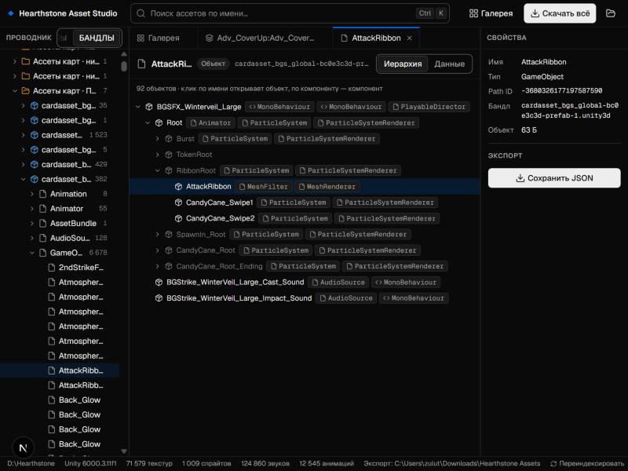
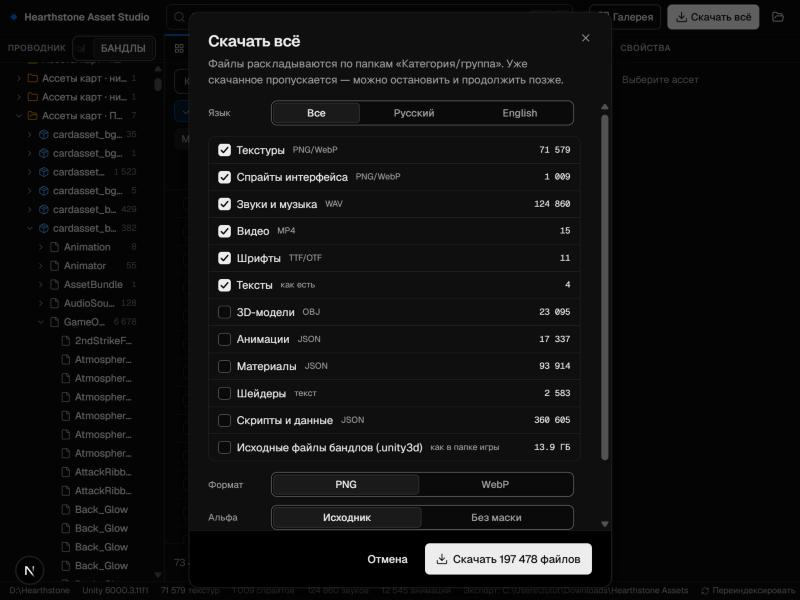

# Hearthstone Asset Studio

Настольное приложение для просмотра и выгрузки ресурсов установленного клиента **Hearthstone**:
картинки и элементы интерфейса, арт карт, звуки и музыка, видео, шрифты, 3D-модели, анимации,
материалы, префабы и любые другие объекты Unity. Работает локально с файлами игры на вашем компьютере.



## Возможности

- **Проводник как в IDE.** Дерево «Тип → группа → ассет» или «Бандл → объекты», поиск по имени (`Ctrl+K`),
  вкладки, панель свойств, понятные названия групп («Арт карт · Поля сражений · RU»).
- **Просмотр всего.**
  - Картинки: зум колесом, перетаскивание, пиксельная сетка, пипетка, каналы RGBA / RGB / альфа.
  - Звук, видео и шрифты (с образцом текста, кириллица тоже).
  - 3D-модели: вращение и каркас.
  - Префабы: иерархия объектов и компонентов (частицы, меши, звуки, аниматоры).
  - Любой объект: вкладка «Данные» с кликабельными ссылками между ассетами.
- **Галерея для обложек.** Картинки сеткой с пресетами «Интерфейс», «Арт карт», «Портреты и золотые»;
  звуки списком с прослушиванием (существа, заклинания, музыка…, RU/EN); видео и шрифты.
- **Элементы UI-атласов.** Кнопка «Элементы» сама находит отдельные детали на атласе (рамки, кристаллы,
  значки) и вырезает каждую в свой файл. «Выделение» сохраняет любую область.
- **Покадровые анимации (флипбуки).** Спрайт-лист эффекта нарезается на кадры; сетка подбирается
  автоматически. Сохранение в WebP / APNG без потерь, папку PNG-кадров или GIF.
- **Скачать всё.** У каждого узла дерева есть кнопка «Скачать», также доступны «Скачать все» в поиске
  и галерее и общий диалог «Скачать всё» с выбором категорий и языка. Файлы раскладываются по папкам
  `Категория/группа/имя`. Уже скачанное пропускается, так что выгрузку можно остановить и продолжить.
  Можно скопировать и исходные бандлы `.unity3d` как есть.



## Только исходники

Экспорт ничего не дорисовывает и не пережимает: всё сохраняется так, как хранится в игре.

| Что | Формат |
|---|---|
| Текстуры, спрайты, элементы атласов | PNG или WebP без потерь |
| Звуки и музыка | WAV (декодировано без потерь) |
| Видео | исходный MP4 |
| Шрифты | TTF / OTF |
| 3D-модели | OBJ |
| Анимации, материалы, префабы, скрипты | JSON (все поля объекта) |
| Шейдеры, тексты | как есть |
| Бандлы | исходные `.unity3d` |

У арта карт альфа-канал служит маской эффектов, поэтому «как есть» он выглядит бледным. Для обложек есть
режим альфы «Без маски»: он убирает такую маску и не трогает настоящую прозрачность интерфейса.

## Установка и запуск

1. Скачайте `HearthstoneAssetStudio.exe` из [Releases](../../releases) (Windows 10/11, 64-бит).
2. Запустите его. При первом запуске Windows может показать «Система Windows защитила ваш компьютер»:
   файл не подписан сертификатом. Нажмите «Подробнее» → «Выполнить в любом случае».
3. Откроется окно приложения. Игра находится автоматически: через реестр, базу Battle.net и типичные
   папки на всех дисках. Если не нашлась, укажите папку вручную (кнопка «Обзор…»). Её можно взять в
   Battle.net: шестерёнка у кнопки «Играть» → «Показать в проводнике».
4. Первый запуск составляет индекс ресурсов, это 1–2 минуты. При обновлении игры индекс пересоберётся сам.

Файлы сохраняются в `Загрузки\Hearthstone Assets`; папку можно сменить кликом по пути в строке состояния.
Приложение закрывается вместе с окном (сервер выходит сам, когда окно закрыто и выгрузок нет).

| Где | Что |
|---|---|
| `%LOCALAPPDATA%\HearthstoneAssetStudio\index.db` | индекс ассетов |
| `%LOCALAPPDATA%\HearthstoneAssetStudio\thumbs`, `media` | кеш миниатюр и превью |
| `%LOCALAPPDATA%\HearthstoneAssetStudio\settings.json` | папка игры и папка экспорта |
| `%LOCALAPPDATA%\HearthstoneAssetStudio\app.log` | журнал (пригодится при ошибках) |

Нужен Microsoft Edge или Google Chrome (Edge есть в Windows по умолчанию); без них приложение
откроется в браузере по умолчанию.

## Где что лежит в игре

| Группа бандлов | Содержимое |
|---|---|
| `initial_*`, `essential_*` | интерфейс, атласы, меши, анимации, шейдеры, шрифты |
| `cardtexture_*` | арт карт |
| `portpremium_*` | портреты героев и золотые карты |
| `cardasset_*`, `carddef_*` | эффекты и описания карт (префабы) |
| `sound*`, `playsound_*` | звуки (по языкам: `_ruru`, `_enus`…) |
| `musicexpansion_*`, `heromusic_*` | музыка |
| `video_*` | ролики |

## Разработка

Нужны Python 3.13, Node.js 20+ и [uv](https://docs.astral.sh/uv/).

```bash
uv venv .venv
uv pip install --python .venv/Scripts/python.exe -r requirements.txt
cd web && npm install && cd ..
```

```bash
.venv/Scripts/python.exe hsserver.py --dev     # API на http://127.0.0.1:8765
npm --prefix web run dev                        # интерфейс на http://localhost:3000
```

Сборка `dist\HearthstoneAssetStudio.exe` (интерфейс, сервер и зависимости в одном файле):

```bash
uv pip install --python .venv/Scripts/python.exe pyinstaller
packaging\build.bat
```

### Как устроено

- `hsserver.py`: локальный HTTP-сервер на [UnityPy](https://github.com/K0lb3/UnityPy). Он строит индекс
  в SQLite, декодирует текстуры, звук (FMOD) и видео и разрешает ссылки между бандлами (зависимости
  догружаются по индексу CAB → бандл). Ещё на нём экспорт фоновыми заданиями, нарезка атласов
  (scipy) и подбор сетки флипбуков. Версию Unity Blizzard вырезает из бандлов, поэтому она берётся
  из `globalgamemanagers`.
- `web/`: интерфейс на Next.js (статический экспорт) и компонентах [ValyroUI](https://valyro.xyz);
  3D через three.js.
- `packaging/`: спецификация PyInstaller, иконка, сборка.
- `hsextract.py`: утилита командной строки для пакетной выгрузки без интерфейса.

### Утилита командной строки

```bash
.venv/Scripts/python.exe hsextract.py scan                              # индекс -> out/index.csv
.venv/Scripts/python.exe hsextract.py extract                           # картинки, звук, видео, шрифты, тексты
.venv/Scripts/python.exe hsextract.py extract -t textures --bundle "cardtexture*" --rgb
.venv/Scripts/python.exe hsextract.py extract -t audio --bundle "*_ruru*" --name "vo_"
.venv/Scripts/python.exe hsextract.py extract -t all --out D:/hs_dump --game "D:/Hearthstone"
```

Категории: `textures, sprites, audio, video, fonts, text, meshes, shaders, animations, materials, mono`.

## Правовая оговорка

Проект не связан с Blizzard Entertainment. Hearthstone и все ресурсы игры принадлежат Blizzard.
Репозиторий содержит только код и не содержит файлов игры. Извлечённые ресурсы — для личного
использования; соблюдайте условия Blizzard при их публикации.
